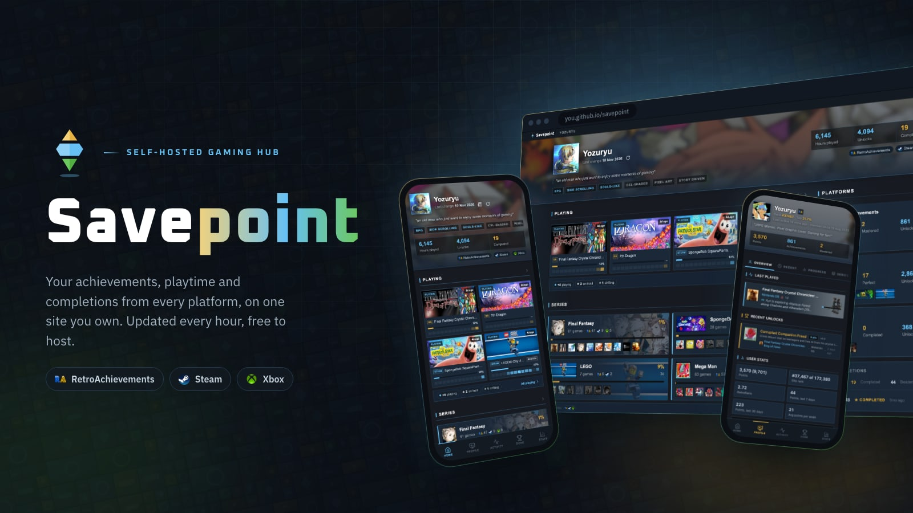
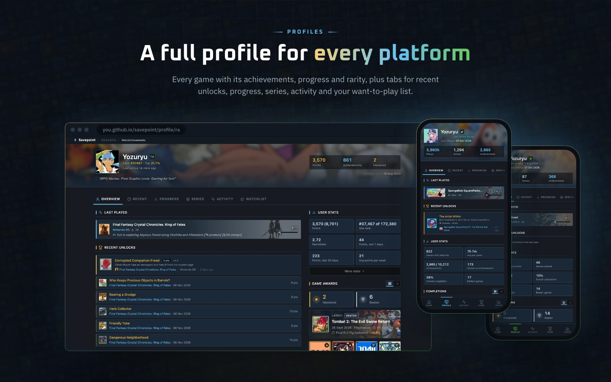
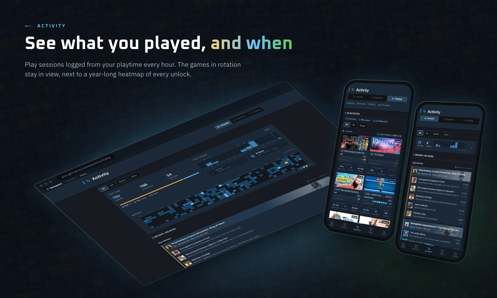
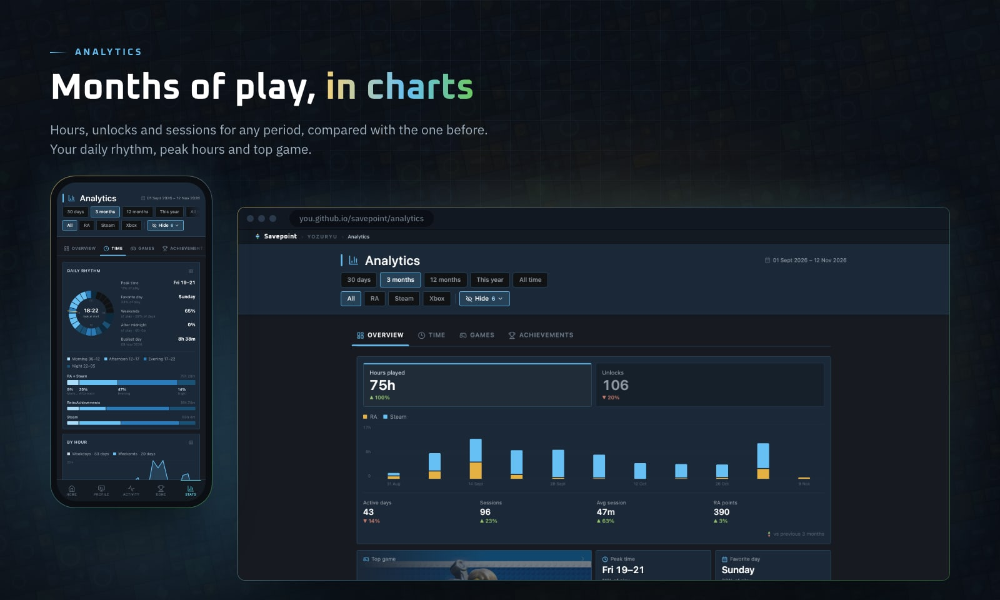
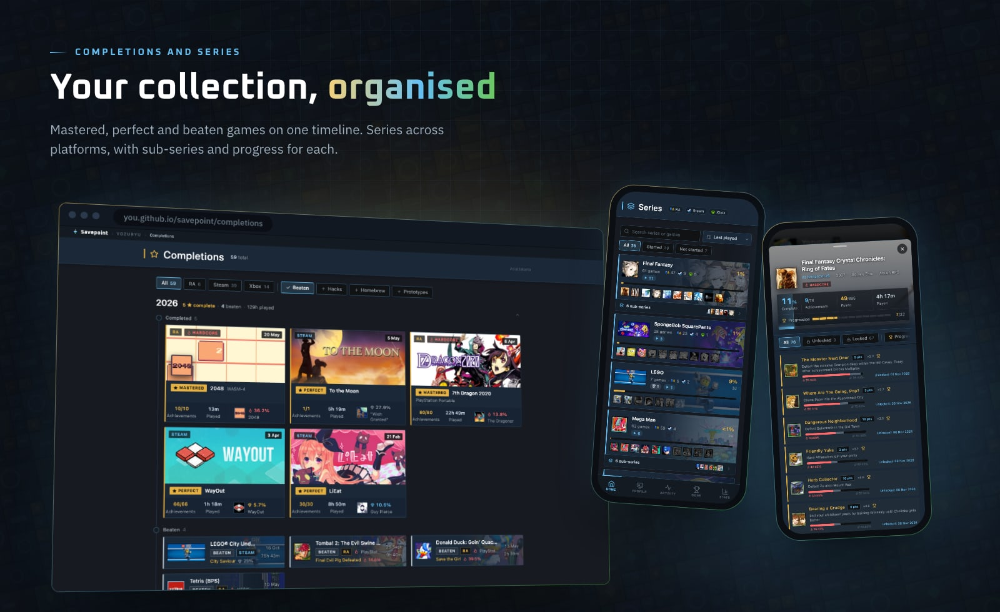
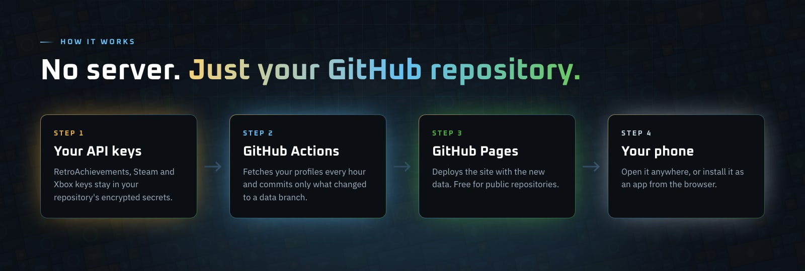
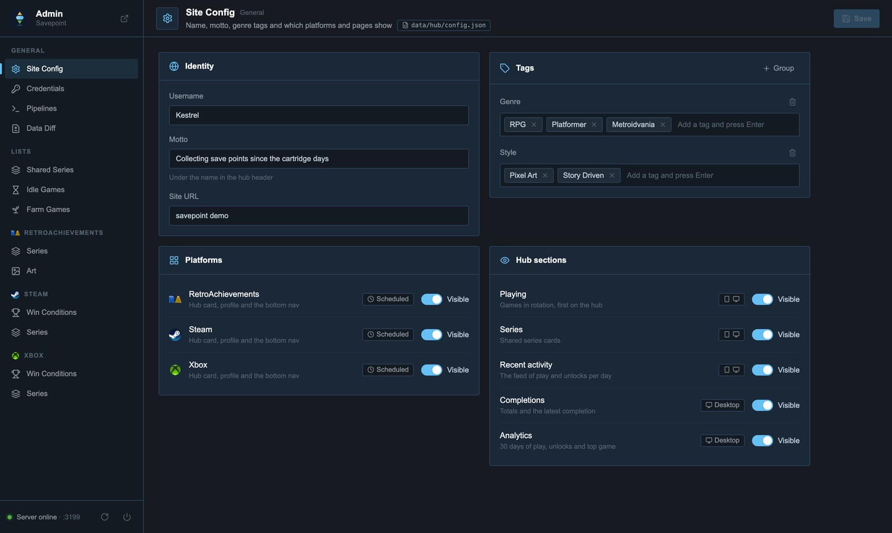
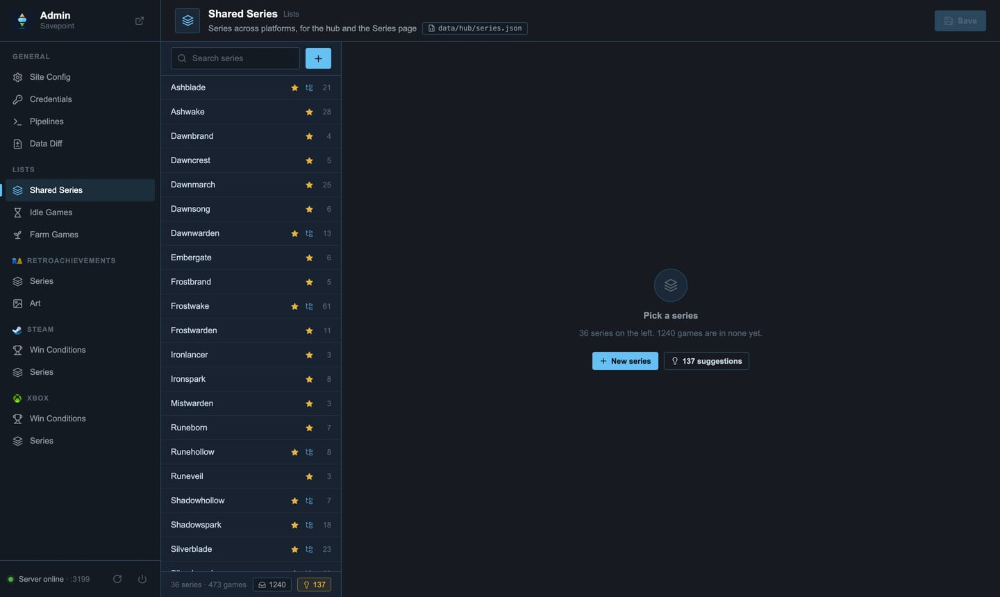
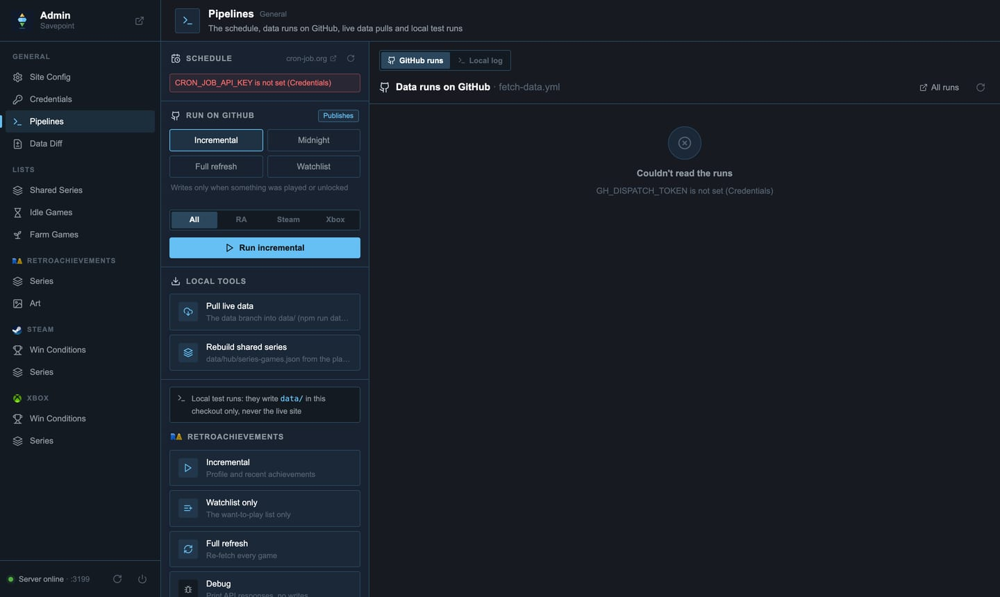

<p align="center">
  
</p>

<p align="center">
  <b>Your RetroAchievements, Steam and Xbox progress on one site you own.</b><br>
  Updated every hour by GitHub Actions, hosted free on GitHub Pages. No server, no database, no subscription.
</p>

<p align="center">
  <a href="https://yozuryu.github.io/savepoint-site/">Website and docs</a> ·
  <a href="https://yozuryu.github.io/savepoint-site/#demo">Live demo</a> ·
  <a href="#setup">Set up your own</a> ·
  <a href="#the-admin-panel">Admin panel</a>
</p>

---

Savepoint is a template. You make your own copy, add your API keys as secrets, and in about fifteen minutes you have a personal gaming hub at `https://<you>.github.io/savepoint/` that keeps itself up to date. It is designed for your phone first and installs as an app.



## What you get

- **Hub**: the games you are playing, your series, your latest activity and every platform's headline numbers on one page.
- **A profile per platform**: every game with its achievements, progress, rarity and art; recent unlocks, progress, series, activity and your RetroAchievements want-to-play list.
- **Activity**: unlocks and play sessions day by day, the games in rotation, streaks and a year-long heatmap.
- **Analytics**: hours, unlocks and sessions for any period, compared with the one before; peak hours, favourite day, top games, rarest unlocks.
- **Completions**: mastered, perfect and beaten games across all platforms on one timeline.
- **Series**: group games into series across platforms, with sub-series and progress for each.
- **Admin panel** on your computer to edit series, pick art for games, set win conditions, start data runs and publish.





## How it works



- `.github/workflows/fetch-data.yml` runs every hour. It calls the RetroAchievements, Steam and Xbox APIs with your keys and saves the results as JSON on a branch called `data`. Runs with nothing new write nothing.
- When data changed, `.github/workflows/deploy.yml` combines `main` (the site) with the `data` branch and publishes it to GitHub Pages.
- The site is plain HTML and JavaScript that reads those JSON files. There is no build step and nothing to host.

You can use any combination of the three platforms. A platform without its keys is skipped.

---

## Setup

You need a GitHub account and an API key for each platform you want. Everything happens in the browser; you don't need to install anything.

### 1. Create your repository

1. At the top of this page, click **Use this template → Create a new repository**.
2. Name it `savepoint` (the name becomes the address: `https://<you>.github.io/savepoint/`).
3. Keep it **Public**. GitHub Pages is free for public repositories, and Actions minutes are unlimited for them.
4. Click **Create repository**.

> Use the template button rather than **Fork**. A fork can't be made private later, carries this repository's history, and GitHub turns off scheduled workflows in forks.

### 2. Turn on GitHub Pages

In your new repository: **Settings → Pages → Build and deployment → Source: GitHub Actions**.

That's the only setting. Don't pick a branch.

### 3. Get your API keys

<details open>
<summary><b>RetroAchievements</b></summary>

1. Sign in at [retroachievements.org](https://retroachievements.org).
2. Open **Settings**, find **Keys**, and copy your **Web API Key**.

You need two values: your username and that key.
</details>

<details open>
<summary><b>Steam</b></summary>

1. Get an API key at [steamcommunity.com/dev/apikey](https://steamcommunity.com/dev/apikey). Any domain name works (for example `localhost`).
2. Find your **SteamID64**, the 17-digit number starting with `7656119`: it's in your profile URL if you never set a custom one, or paste your profile URL into [steamid.io](https://steamid.io).
3. In Steam, **Edit Profile → Privacy Settings**: set **My profile** and **Game details** to **Public**. With private game details, Steam returns nothing.
</details>

<details open>
<summary><b>Xbox</b></summary>

Xbox has no public API for this, so Savepoint uses [OpenXBL](https://xbl.io), a free service that signs in with your Microsoft account.

1. Sign in at [xbl.io](https://xbl.io) with the Microsoft account you play on.
2. Open your profile and create an **API key**.

The free plan allows 150 requests an hour, which is plenty: a normal run uses two or three. OpenXBL sometimes answers "too many requests" even with quota left; the next run picks it up.
</details>

### 4. Add the keys as secrets

In your repository: **Settings → Secrets and variables → Actions → New repository secret**. Add one secret per row, for the platforms you use:

| Secret | Platform | Value |
|---|---|---|
| `RA_USERNAME` | RetroAchievements | Your username |
| `RA_API_KEY` | RetroAchievements | Your Web API Key |
| `STEAM_API_KEY` | Steam | Your Steam Web API key |
| `STEAM_USER_ID` | Steam | Your 17-digit SteamID64 |
| `XBOX_API_KEY` | Xbox | Your OpenXBL API key |
| `XBOX_XUID` | Xbox (optional) | Only compared with the account the key belongs to |

Secrets are encrypted and only visible to the workflows. They never end up in the site or the data.

### 5. Make it yours

Open `data/hub/config.json` in your repository and click the pencil icon to edit it:

```json
{
  "username": "Player One",
  "motto": "Every save point tells a story",
  "avatar": "",
  "tags": { "genre": ["RPG", "Platformer"], "style": ["Pixel Art", "Story Driven"] },
  "platforms": {
    "retroachievements": { "visible": true },
    "steam": { "visible": true },
    "xbox": { "visible": true }
  }
}
```

- `username`, `motto` and `tags` appear in the hub header.
- `avatar`: any image URL (for example `https://avatars.githubusercontent.com/<your-github-name>`), or leave it empty and replace `assets/avatar.png`.
- `platforms`: set a platform you don't use to `"visible": false` (see [Platforms](#turning-platforms-on-and-off)).

Commit the change. That push deploys the site for the first time (without data yet).

### 6. Run the first data fetch

1. Open the **Actions** tab. If GitHub asks, click **I understand my workflows, go ahead and enable them**.
2. Pick **Fetch Data** on the left, then **Run workflow**. Set **mode** to `full-refresh` and click the green button.
3. Wait for it to finish: a few minutes for a small library, up to half an hour for a big Steam one. When it changed data, a **Deploy** job runs right after.

Your hub is now at `https://<you>.github.io/savepoint/`. From here it updates itself every hour.

### 7. Put it on your phone

Open the site on your phone and choose **Add to Home Screen** (Safari) or **Install app** (Chrome). It opens full screen like an app, and **Refresh app** in the hub header loads a new version right away.

---

## Turning platforms on and off

Two separate switches, so you can stop syncing a platform without hiding it, or hide one without losing its data.

| You want to… | Do this |
|---|---|
| Not use a platform at all | Don't add its secrets, and set it to `"visible": false` in `data/hub/config.json` |
| Hide a platform on the site | `"visible": false` in `data/hub/config.json` (or **Admin → Site Config → Platforms**) |
| Stop syncing a platform but keep showing its data | In `.github/workflows/fetch-data.yml`, set its line to `'false'`: `RA_ENABLED`, `STEAM_ENABLED` or `XBOX_ENABLED` |
| Sync a paused platform once | **Actions → Fetch Data → Run workflow** with **platforms** set to that platform |
| Hide a section of the hub | `"visible": false` under `playing`, `series`, `activity`, `completions` or `analytics` in `config.json` (or **Admin → Site Config → Hub sections**) |

A platform without its secrets is always skipped, and the run says so in its summary.

## Scheduling

Out of the box, `fetch-data.yml` runs:

| When | Mode | What it does |
|---|---|---|
| Every hour (`17 * * * *`) | `incremental` | Fetches recent activity; writes only when you played or unlocked something |
| Daily at 00:05 UTC | `midnight` | Refreshes everything slower to change: rarity, ranks, RetroAchievements game details |

GitHub runs scheduled workflows when it has capacity, often 10 to 60 minutes late and sometimes later. That's fine for most people. If you want updates on time, use an external cron.

### Optional: on-time updates with cron-job.org

[cron-job.org](https://cron-job.org) is free and can start the workflow through GitHub's API.

1. **Create a GitHub token**: [github.com/settings/personal-access-tokens/new](https://github.com/settings/personal-access-tokens/new) → fine-grained token → **Only select repositories**: your `savepoint` → **Permissions → Actions: Read and write**. Copy the token.
2. **Create a job** on cron-job.org:
   - **URL**: `https://api.github.com/repos/<you>/savepoint/actions/workflows/fetch-data.yml/dispatches`
   - **Schedule**: every 30 minutes
   - **Advanced → Request method**: `POST`
   - **Headers**:
     - `Authorization`: `Bearer <your token>`
     - `Accept`: `application/vnd.github+json`
     - `X-GitHub-Api-Version`: `2022-11-28`
   - **Request body**: `{"ref":"main","inputs":{"mode":"incremental","platforms":"all"}}`
3. **Create a second job** for the daily refresh: same settings, schedule daily at midnight, body `{"ref":"main","inputs":{"mode":"midnight","platforms":"all"}}`.
4. Optional: remove the two `cron:` lines under `schedule:` in `fetch-data.yml` so the runs aren't doubled. Keeping them is harmless; they act as a fallback.

A successful dispatch answers `204 No Content`. When the token expires, update it in both jobs.

Data run modes, for manual runs and cron jobs:

| Mode | Use |
|---|---|
| `incremental` | The regular run. Cheap; writes only on activity |
| `midnight` | Daily refresh of rarity, ranks and the slower data |
| `full-refresh` | Every game on every platform. The first run, or to repair data. Slow and uses a lot of API quota |
| `watchlist-only` | Only the RetroAchievements want-to-play list |

---

## The admin panel



The admin panel runs on your own computer and is never deployed. It edits the files in your repository, so you need a local copy:

```sh
git clone https://github.com/<you>/savepoint.git
cd savepoint
npm install
cp .env.example .env      # then fill in your keys
npm run data:pull         # downloads your data branch into data/
npm run admin             # http://localhost:3131
```

You need [Node.js](https://nodejs.org) 20 or newer. `.env` holds the same keys as your GitHub secrets (for local test runs) and is ignored by git. `PORT=3200 npm run admin` runs it on another port.

| Page | What it's for |
|---|---|
| **Site Config** | Name, motto, tags, which platforms and hub sections are visible |
| **Credentials** | Edit `.env` |
| **Pipelines** | Start real data runs on GitHub (needs `GH_DISPATCH_TOKEN`), run the pipelines locally as a test, and manage your cron-job.org jobs (needs `CRON_JOB_API_KEY`) |
| **Data Diff** | What you changed, then **Commit**, **Push** or **Publish** both |
| **Shared Series** | Series that mix platforms, shown on the Series page |
| **Idle Games / Farm Games** | Games left running (idlers) or achievement farms to leave out of Playing and Analytics |
| **RetroAchievements → Series / Art** | Series for the RA profile; pick wide art and stand-in icons from SteamGridDB (needs `SGDB_API_KEY`) |
| **Steam / Xbox → Win Conditions** | The achievement that means "beaten" for a game, so it counts as beaten |
| **Steam / Xbox → Series** | Series for those profiles |

 

Changes are saved to files in `data/`. They reach your site when you commit and push them (**Data Diff → Publish**, or plain `git`).

Optional keys for the admin, all in `.env`:

| Key | Used for |
|---|---|
| `SGDB_API_KEY` | Art picking: [steamgriddb.com](https://www.steamgriddb.com) → Preferences → API |
| `GH_DISPATCH_TOKEN` | Starting and listing data runs from **Pipelines** (the same kind of token as for cron-job.org) |
| `CRON_JOB_API_KEY` | Managing your cron-job.org jobs from **Pipelines**: cron-job.org → Settings → API |
| `GITHUB_REPOSITORY`, `SITE_URL` | Only if your repository or site address can't be worked out from the git remote |

---

## Customising

- **Fallback art**: games with no art show a mosaic. After your first data run, `npm run build:fallback-art` builds it from your own library's icons and covers (`assets/art-fallback.webp`).
- **Custom domain**: **Settings → Pages → Custom domain**. Everything works under any address.
- **Colours and layout**: the site is plain files: pages in their folders (`profile/ra/`, `activity/`, …), shared styles in `assets/ui.css`. Edit and push; there is no build step.
- **Changelog**: `changelog.md` is shown at `/changelog/`. Keep your own notes there, or ignore it.
- **Posters**: the images in this README are made by `npm run posters` from screenshots of your own site (after `npm run data:pull`, and `npx playwright install chromium` once). Run it again after changing the look. `--header-art <image url>` puts one picture behind the hub and RA headers instead of your latest game. The other options are listed at the top of `scripts/posters.js`.

## Getting updates

The **Template updates** workflow checks this template every Monday (or when you run it from the Actions tab) and opens a pull request with whatever is new. Merge it and your site updates. Your config, series, art picks and avatar keep your version (`.gitattributes`).

It needs two things:

- **Settings → Actions → General → Allow GitHub Actions to create and approve pull requests** turned on.
- One first merge by hand, because a copy made from a template doesn't share its history yet:

```sh
git remote add template https://github.com/yozuryu/savepoint.git
git fetch template
git merge template/main --allow-unrelated-histories
```

Every file you changed shows as a conflict this one time: keep your own `data/hub/config.json` and series files, take the template's version of the rest. After that the workflow merges on its own and only opens an issue when a file changed on both sides. GitHub's own token can't push changes to workflow files, so when an update touches `.github/workflows` the workflow asks for a `TEMPLATE_SYNC_TOKEN` secret (a personal access token with the repo and workflow scopes).

## Troubleshooting

| Problem | Fix |
|---|---|
| The site shows GitHub's 404 page | **Settings → Pages → Source** must be **GitHub Actions**. Then re-run **Deploy site** from the Actions tab |
| A profile says "No data yet" | Run **Fetch Data** with `full-refresh`, and check that platform's secrets |
| The run summary says a platform was skipped | Its secrets are missing or misspelled (names are case-sensitive) |
| Steam shows no games | Your Steam **Game details** privacy setting must be **Public** |
| Xbox fails with 429 | OpenXBL's rate limit; it succeeds on a later run |
| The site stopped updating | GitHub turns off scheduled workflows in repositories with no activity for 60 days. Re-enable **Fetch Data** in the Actions tab (or use cron-job.org, which keeps it busy) |
| The app on my phone shows an old version | **Refresh app** (the circular arrow in the hub header) |

## Privacy

Your repository and site are public, so your stats and play history are public too, like your profiles on the platforms themselves. Your API keys are not: they live in GitHub's encrypted secrets and your local `.env`, which is never committed.

## License

[MIT](LICENSE): free to use, change and share, including for your own projects.

Savepoint isn't affiliated with RetroAchievements, Valve, Microsoft or OpenXBL. Game names, icons and art belong to their owners and are loaded from the platforms' own servers. The screenshots in this README show the author's own hub.
